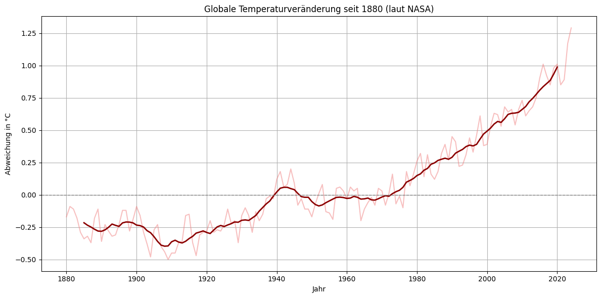
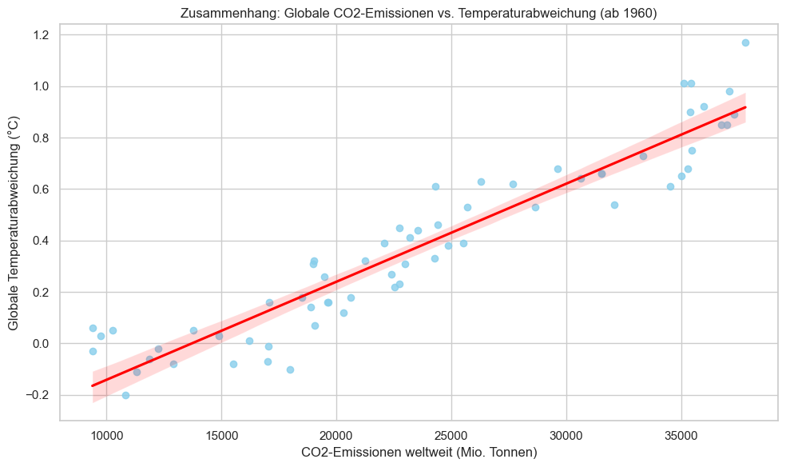
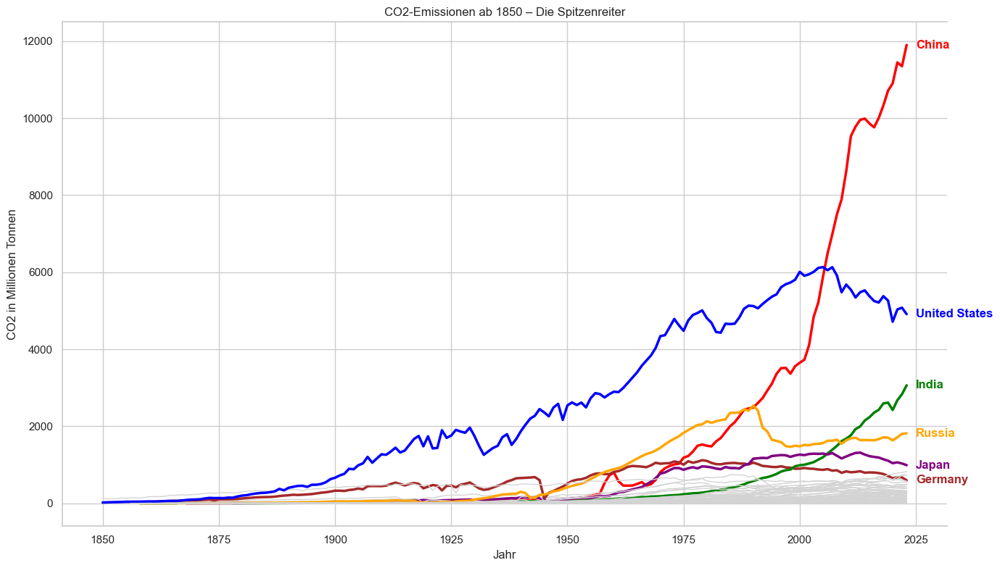
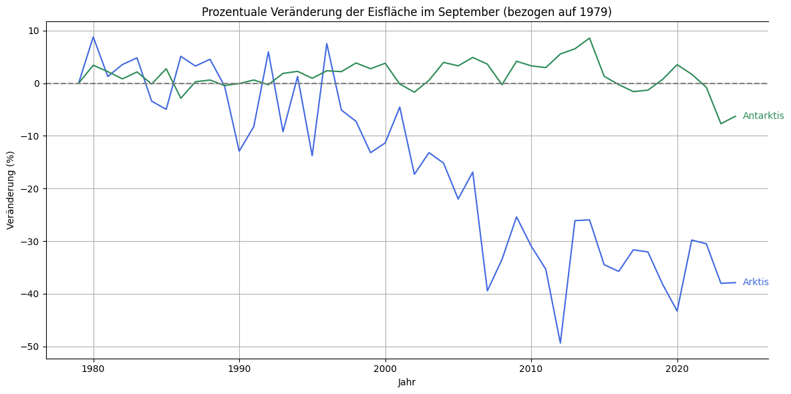

# Climate Change in Data

Is climate change measurable? Where do CO2 emissions come from, who emits how much, and how is the world already changing? This project answers these questions with public data from NASA, Our World in Data and other sources, from data cleaning to interactive world maps.

| | |
|---|---|
| Course | Data Science II, B.Sc. Artificial Intelligence, Landshut University of Applied Sciences |
| Semester | 2nd semester, summer 2025 |
| Team | Adam, Farouk |
| Grade | 1.0 |
| Language | Notebook is written in German |

## Interactive maps

Built with Plotly, live in the browser:

- [Animated world map of CO2 emissions, 1900 to today](https://adamst-git.github.io/climate-change-in-data/Karte-CO2-Animation.html)
- [CO2 emissions per person, 2023](https://adamst-git.github.io/climate-change-in-data/Karte-Pro-Person.html)
- [Sunburst: CO2 emissions by continent and country, 2023](https://adamst-git.github.io/climate-change-in-data/SunBurst.html)

## Selected findings

| | |
|---|---|
|  |  |
| Global temperature is about 1 °C above the 1951–1980 average and has risen almost without a break since 1980. | Since 1960, global CO2 emissions and the temperature anomaly are closely linked. |
|  |  |
| China overtook the USA around 2005 and now emits more than twice as much. Per person, small Gulf states lead. | Arctic sea ice in September has shrunk by about 40 % since 1979. |

## Structure of the notebook

0. **Greenhouse gases:** why CO2 matters most
1. **Is climate change real?** NASA temperature data by year, by month and by decade, plus the link to CO2
2. **Since when and why?** Emissions since 1880, by sector, population growth and transport
3. **Who emits how much?** Countries, continents, totals vs. per capita, focus on Asia
4. **How is the world changing?** Sea level, sea ice, extreme weather and climate-related diseases

The original presentation (62 slides) is not included because it contains third-party images. All charts shown here come from our own notebook.

## Data sources

The raw data is not included in this repository.

| Data | Source |
|---|---|
| CO2 emissions by country | [Our World in Data, CO2 data](https://github.com/owid/co2-data) |
| Global temperature | [NASA GISTEMP](https://data.giss.nasa.gov/gistemp/) |
| Population | [Our World in Data](https://ourworldindata.org/grapher/population) |
| Transport emissions | [Our World in Data](https://ourworldindata.org/grapher/co2-emissions-transport) |
| Emissions by sector | [Our World in Data](https://ourworldindata.org/grapher/co-emissions-by-sector) |
| Sea level | [NASA Sea Level](https://sealevel.nasa.gov/) |
| Sea ice | [NSIDC Sea Ice Index](https://nsidc.org/data/g02135) |
| Natural disasters | [Kaggle, EM-DAT 1900–2021](https://www.kaggle.com/datasets/brsdincer/all-natural-disasters-19002021-eosdis) |
| Climate-related diseases | [Kaggle](https://www.kaggle.com/datasets/hopeofchange/climate-driven-disease-spread) |

Chapters 0 to 3 were run again for this repository. The charts in chapter 4 come from our original run.

## Files

| File | Content |
|---|---|
| `climate_change_in_data.ipynb` | the full notebook with all charts |
| `docs/` | the three interactive Plotly maps |
| `images/` | charts used in this README |
| `requirements.txt` | Python packages |

## Run it yourself

Download the CSV files from the sources above, save them next to the notebook, then:

```bash
pip install -r requirements.txt
jupyter notebook climate_change_in_data.ipynb
```
